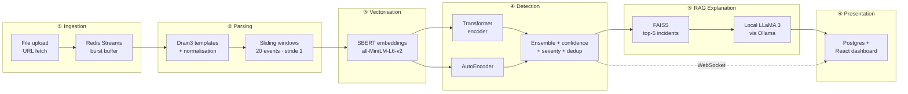

<div align="center">

# 🛡️ LogGuard

### Log anomaly detection with RAG-powered root cause analysis

*An ensemble of deep-learning models scores your logs as they arrive, and a local LLaMA 3 explains each anomaly in plain English with a recommended fix.*

<br/>

[](https://www.python.org/)
[](https://fastapi.tiangolo.com/)
[](https://pytorch.org/)
[](https://react.dev/)
[](https://www.typescriptlang.org/)
[](https://www.docker.com/)

<br/>


</div>

---

## 📖 Table of Contents

<details open>
<summary><b>Click to expand / collapse</b></summary>

- [Why LogGuard](#-why-logguard)
- [Key Features](#-key-features)
- [Architecture](#%EF%B8%8F-architecture)
- [The Detection Models](#-the-detection-models)
- [Tech Stack](#-tech-stack)
- [Results](#-results)
- [Quick Start](#-quick-start)
- [LLaMA / GPU Deployment](#-llama--gpu-deployment)
- [Project Structure](#-project-structure)
- [Documentation](#-documentation)

</details>

---

## 💡 Why LogGuard

Most log-anomaly tools either flag anomalies or explain them. LogGuard does both in one pipeline: a Transformer + AutoEncoder ensemble scores each window of log events, a small learned scorer attaches a confidence value, and a retrieval-augmented local LLaMA writes the root cause.

> Log lines are buffered in Redis Streams, parsed into Drain3 templates and grouped into sliding windows of 20 events. Each window is scored by the ensemble. For every anomaly, FAISS retrieves the most similar past incidents and a **local** LLaMA 3 writes an explanation. Log data never leaves your infrastructure.

---

## ✨ Key Features

| | Feature | What it does |
|---|---|---|
| 🔎 | **Ensemble anomaly detection** | A Transformer encoder (sequence patterns) and an AutoEncoder (reconstruction error) are combined with weights tuned by grid search. |
| 🎯 | **Confidence score** | A small MLP rates how sure the ensemble is about each call. The score is shown next to every anomaly. |
| 🚦 | **Severity tiers** | Each anomaly is tagged `critical`, `warning` or `info` from its ensemble score. |
| 🧠 | **RAG root cause** | FAISS retrieves the 5 most similar historical incidents; local LLaMA 3 turns them into a plain-English root cause and recommended fix. |
| 🔒 | **Privacy-first** | LLaMA runs locally via Ollama. Log data, which often holds credentials and customer identifiers, never goes to a third-party API. |
| 🧩 | **Deduplication** | Anomalies with the same template and source within 60 seconds are grouped into one cluster. |
| 🔁 | **Engineer feedback** | Engineers mark each anomaly as a true or false positive; the label is stored with the anomaly. |
| ⚡ | **Live dashboard** | React + WebSocket UI with an anomaly timeline, per-line attention scores, and explanations that appear as soon as they are written. |

---

## 🏗️ Architecture

**Six layers.** Logs flow left to right; stages are decoupled by Redis so bursts are buffered rather than dropped.



<div align="center"><i>Detection: under 100 ms per window on CPU. &nbsp;•&nbsp; Explanation: 25-35 s on CPU (llama3.2:1b), 3-5 s on GPU (llama3:8b).</i></div>

---

## 🧠 The Detection Models

<details>
<summary><b>Transformer encoder</b>: sequence-aware anomaly scoring</summary>

<br/>

- 4 layers · 8 attention heads · 256-d hidden · feed-forward 1024 · dropout 0.1 · GELU
- Self-attention relates every event in the 20-event window to every other event
- **Two heads:** binary anomaly classifier + a minutes-to-failure regressor. The regressor only learns where time-to-failure labels exist; the LogHub corpora used here have none, so `predicted_failure_window_min` is usually null.
- Last-layer attention weights are kept at inference and shown as per-line scores in the UI
- AdamW, `lr=1e-4`, gradient clipping (max norm 1.0), cosine schedule, capped positive-class weight (max 10), early stop on validation F1

</details>

<details>
<summary><b>AutoEncoder</b>: reconstruction-error novelty detection</summary>

<br/>

- 384 → 256 → 128 → 64 → 128 → 256 → 384, ReLU, MSE loss
- **Trained only on normal windows**, so anomalous windows reconstruct poorly
- Error is normalised by percentile clip-and-scale against training-time error

</details>

<details>
<summary><b>Ensemble, confidence & severity</b></summary>

<br/>

- Weighted ensemble: `score = w₁·σ(transformer) + w₂·ae_error_norm`, with `w₁ + w₂ = 1` and both weights and the anomaly threshold grid-searched on validation data
- Confidence MLP over `(transformer_score, ae_error, sequence_length, time_of_day)`; its threshold is set in `thresholds.json`
- Deduplication by `(template, source, 60 s window)`
- Severity: `critical` above 0.95, `warning` above 0.75, otherwise `info`

</details>

---

## 🧰 Tech Stack

<table>
<tr><td valign="top" width="50%">

### Backend & ML


- **Drain3** - log template extraction
- **sentence-transformers** - `all-MiniLM-L6-v2` window embeddings
- **FAISS** - similarity search over past incidents
- **Ollama + LLaMA 3** - local generative root cause

</td><td valign="top" width="50%">

### Frontend


- **TanStack Query** · **React Router** · **Recharts** · **Framer Motion**

### Data & Infra


### Quality & CI


</td></tr>
</table>

---

## 📊 Results

Two models were trained and evaluated on a **70 / 15 / 15** split (seed 99). Test slices were held out of training **and** threshold calibration. **Apache** logs were never seen by either model.

- **Model A**: OpenStack only
- **Model B**: OpenStack + a 100,000-line stratified HDFS sample

<div align="center">

| Metric | Model | OpenStack (held-out) | HDFS (held-out) | Apache (never seen) |
|:---|:---:|:---:|:---:|:---:|
| **F1** | A | `0.936` | `0.000` | `0.984` |
| | B | `1.000` | `0.516` | `0.914` |
| **AUC** | A | `0.996` | `0.396` | `0.458` |
| | B | `1.000` | `0.670` | `0.368` |

</div>

> Training on OpenStack alone does not transfer to HDFS (Model A scores F1 of 0.000 there). Joint training lifts HDFS to F1 of 0.516 without hurting OpenStack. Apache is about 99% anomalous, so its high F1 comes with a low AUC; both metrics are reported for that reason.
>
> The RAG index holds **18,454** entries: 18,434 anomalies from the training data plus 20 hand-written incidents covering OOM, disk-full, connection-pool exhaustion, certificate expiry, DNS failure and similar patterns.

<sub>Full methodology, precision/recall and caveats: `backend/training/RESULTS.md`.</sub>

---

## 🚀 Quick Start

> **Prerequisites:** Docker + Docker Compose, Python 3.11, Node 18+, and (optionally) [Ollama](https://ollama.com/) for the RAG worker.

```bash
# 1. Bring up Redis, Postgres, and Ollama
docker compose up -d

# 2. Train the models (runs once, writes everything to backend/artifacts/)
cd backend
python -m training.run_full_pipeline --dataset openstack

# 3. Start the API, ingestion runner and RAG worker (one terminal each)
uvicorn api.main:app --port 8000
python -m ingestion.runner
python -m rag.explainer

# 4. Optional: replay a log file into the pipeline
python -m tools.log_replay --input training/data/openstack/openstack_abnormal.log --rate 100

# 5. Launch the dashboard
cd ../frontend
npm install
npm run dev        # → http://localhost:5173
```

Health check once the stack is up:

```bash
curl http://localhost:8000/api/v1/health
```

Logs can also be sent from the dashboard: the **Upload** page takes a `.log` / `.txt` file up to 50 MB, and the **Connect** page fetches a log file from an HTTP(S) URL.

### One-click start (Windows)

With Docker Desktop running, the backend virtual environment set up in `backend/.venv`, frontend dependencies installed and the trained artifacts in `backend/artifacts/`:

- **`start_demo.bat`** starts Redis (host port `6380`), Postgres and Ollama, then opens four windows for the API, ingestion runner, RAG explainer and dashboard. Each session starts with an empty dashboard.
- Open http://localhost:5173 and upload a `.log` or `.txt` file on the **Upload** page. Anomalies appear as the file is processed, and root-cause explanations follow from the RAG worker.
- **`stop_demo.bat`** closes the four windows and stops the containers.

---

## 🦙 LLaMA / GPU Deployment

The RAG worker calls Ollama once per anomaly, so explanation latency depends on model and hardware:

<div align="center">

| Model | Hardware | Latency per explanation |
|:---|:---:|:---:|
| `llama3.2:1b` | CPU | ~25-35 s |
| `llama3:8b` | GPU | ~3-5 s |

</div>

Two env vars on the RAG worker control this:

```bash
# Default: talk to the docker-compose Ollama on this machine
LOGGUARD_LLAMA_HOST=http://localhost:11434
LOGGUARD_LLAMA_MODEL=llama3:8b

# CPU-only laptop: switch to the smaller model
LOGGUARD_LLAMA_MODEL=llama3.2:1b

# Remote GPU deployment: point at the GPU box's Ollama
LOGGUARD_LLAMA_HOST=http://gpu-box.example:11434
LOGGUARD_LLAMA_MODEL=llama3:8b
```

The remote Ollama must be reachable over HTTP (port `11434`) with the model already pulled (`ollama pull llama3:8b`). `LOGGUARD_LLAMA_TIMEOUT_S` (default `300`) bounds individual call time.

---

## 📁 Project Structure

```
LogGuard/
├── backend/
│   ├── api/            # FastAPI app: routes, WebSocket, upload, URL fetch, persistence
│   ├── ingestion/      # Redis consumer, Drain3 parser, sequence builder
│   ├── ml/             # Transformer, AutoEncoder, ensemble, postprocess
│   ├── rag/            # FAISS client, LLaMA client, prompt templates, explainer
│   ├── training/       # Training + evaluation pipeline
│   ├── tools/          # Log replay tool
│   └── tests/          # pytest suite (unit + integration)
├── frontend/           # React + Vite + TypeScript dashboard
├── docs/architecture/  # System overview, pipelines, API contract, RAG design
├── docker-compose.yml  # Redis · Postgres · Ollama · backend
└── .github/workflows/  # CI: ruff, mypy, pytest
```

---

## 📚 Documentation

| Doc | Contents |
|:---|:---|
| [`system_overview.md`](docs/architecture/system_overview.md) | Six-layer technical walkthrough |
| [`pipelines.md`](docs/architecture/pipelines.md) | Live, training and RAG pipelines |
| [`api_contract.md`](docs/architecture/api_contract.md) | REST + WebSocket API contract |
| [`training_pipeline.md`](docs/architecture/training_pipeline.md) | Data prep → embed → train → calibrate → eval |
| [`rag_design.md`](docs/architecture/rag_design.md) | Prompt templates and example LLaMA outputs |

---

## 🔭 Future Work

- Time-to-failure labels, so the failure regressor can be trained and evaluated
- A scheduled PSI drift job writing to `drift_events`
- Outbound alert routing (PagerDuty, Slack, email) by severity

---

<div align="center">

<sub>Detect early · Explain clearly</sub>

</div>
